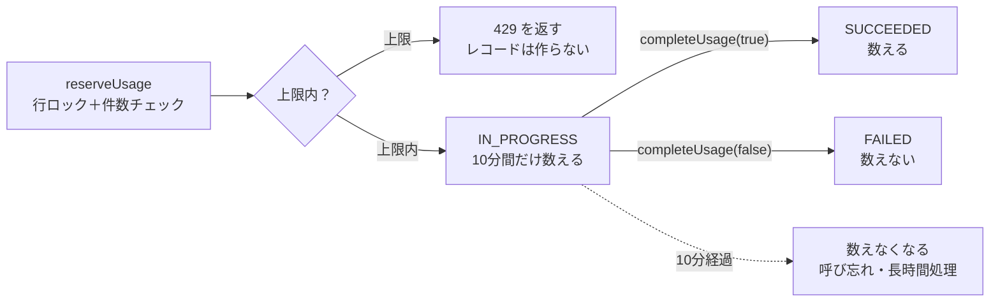

# reserveUsage / completeUsage の使い方

> 対象：分析（Engineer A）と復習の回答（Engineer B）を受け付けるサーバー処理を書く人
> ルール（上限・ウィンドウ・数え方）の根拠は [README.md](README.md) §1 を参照。この資料は「C 側の関数をどう呼ぶか」だけをまとめたもの。
> 最終更新：2026-10-28
> コードへのリンクはファイル単位。行番号はコードが変わるとずれるので書かず、関数名や定数名で示す。

## 要点

分析・復習の回答を受け付けるサーバー処理では、重い処理の **前に** `reserveUsage()` を呼び、終わったら **必ず** `completeUsage()` を呼ぶ。上限チェック・ウィンドウ管理・同時リクエスト対策は C 側で行うので、A/B は2つの関数を呼ぶだけでよい。

- `reserveUsage(userId, kind)`：上限を確認し、「実行中」の利用レコードを1件作ってその id を返す。上限なら `AppError` を投げる（→ 429）。
- `completeUsage(id, succeeded, tx)`：その利用レコードを「成功」または「失敗」にする。失敗は回数に数えない。3つ目の引数には、保存のトランザクションの中なら `tx`、外なら `prisma` を渡す。
- 実装：[usage.service.ts](../../apps/backend/src/features/usage/usage.service.ts)

## 1. reserveUsage

[usage.service.ts](../../apps/backend/src/features/usage/usage.service.ts)

```ts
reserveUsage(userId: string, kind: UsageKind): Promise<string>
```

上限内なら `IN_PROGRESS` の `UsageRecord` を1件作り、その id を返す。この id はあとで `completeUsage` に渡す。

| 引数 / 戻り値 | 内容 |
|---|---|
| `userId` | **内部の `User.id`**。[requireUser](../../apps/backend/src/middleware/require-user.ts) の後なら `req.user!.id`。Clerk の user id（`authSubject`）ではない |
| `kind` | `"ANALYSIS"`（A：分析1回）または `"REVIEW"`（B：フォローアップ質問への回答1回） |
| 戻り値 | 作った `UsageRecord.id`（UUID） |
| 上限到達（無料） | `AppError("FREE_LIMIT_REACHED")` を投げる → 429 |
| 上限到達（Pro） | `AppError("USAGE_LIMIT_REACHED")` を投げる → 429 |

`reserveUsage` は中で次の処理をしている。呼ぶ側がやる必要はない。

1. interactive transaction の中で `User` の行を `SELECT ... FOR UPDATE` でロックする（同じユーザーの同時リクエストを順番に処理する）。
2. 現在のプラン（FREE / PRO）を決め、必要なら新しい7日間ウィンドウを始める（初回利用・7日経過・プラン切り替え）。
3. ウィンドウ開始以降の `SUCCEEDED` と「10分以内の `IN_PROGRESS`」を数え、上限未満ならレコードを作る。

上限の値は [usage.const.ts](../../apps/backend/src/features/usage/usage.const.ts) の `LIMITS`、10分は同じファイルの `IN_PROGRESS_TIMEOUT_MS`。

## 2. completeUsage

[usage.service.ts](../../apps/backend/src/features/usage/usage.service.ts)

```ts
completeUsage(id: string, succeeded: boolean, tx: Prisma.TransactionClient): Promise<void>
```

`reserveUsage` が返したレコードを `SUCCEEDED`（`true`）または `FAILED`（`false`）にする。`FAILED` は回数に数えないので、ユーザーはその1回分を失わない。

| 引数 | 内容 |
|---|---|
| `id` | `reserveUsage` の戻り値 |
| `succeeded` | 処理が成功したら `true`、サーバー側の理由で失敗したら `false` |
| `tx` | 更新に使う Prisma クライアント。結果の保存と同じトランザクションで「成功」にするときは `prisma.$transaction` の `tx` を、単独で更新するときは `prisma` を渡す。省略できない。渡し忘れて、気づかないうちにトランザクションの外で動くのを防ぐため |

細かい動作は次のとおり。

- `IN_PROGRESS` のレコードだけを更新する。2回目以降の呼び出しは何もしない（先に呼んだ結果が残る）。例：`true` のあとに `false` を呼んでも `SUCCEEDED` のまま。
- 存在しない id を渡してもエラーにならない（`updateMany` で 0 件更新）。間違った id を渡しても気づけないので注意。
- 上限エラーは投げない。投げるのは DB 障害時の Prisma エラーだけ。
- 10分を過ぎた後に呼んでも有効。`IN_PROGRESS` のままなら `SUCCEEDED` になり、もう一度回数に数えられる。

## 3. 呼び出しの流れ



上限ならレコードは作られず 429 になる。作られたレコードは `completeUsage` で `SUCCEEDED` か `FAILED` になり、呼ばれなければ10分後に数えなくなる。

実装例を2つ示す。`parseAnalysisInput`、`runAnalysis`、`findOwnQuestion`、`evaluateAnswer` などは、各自の処理に置き換える部分である。

### 分析の例（A）

```ts
// Path from a router at features/<feature>/routes/*.routes.ts
import { prisma } from "../../../lib/prisma.js";
import { completeUsage, reserveUsage } from "../../usage/usage.service.js";

// requireUser must run before this handler (req.user is our internal User)
router.post("/analyses", async (req, res) => {
  // 1. Validate input first: a 400 must not consume a use
  const input = parseAnalysisInput(req.body);

  // 2. Reserve: throws AppError (429) when the limit is reached
  const usageId = await reserveUsage(req.user!.id, "ANALYSIS");

  let succeeded = false;
  try {
    const result = await runAnalysis(input);
    succeeded = true;
    res.json(result);
  } finally {
    // 3. Always complete: FAILED is not counted
    await completeUsage(usageId, succeeded, prisma);
  }
});
```

`try / finally` にするのは、途中で例外が出ても `completeUsage(id, false, prisma)` が呼ばれ、失敗分がすぐに枠へ戻るためである。例外はそのまま共通 error handler に届く。

分析の結果を1つのトランザクションで保存する場合（仕様書 §28）は、次の復習の例と同じ形にし、保存と同じトランザクションの中で `completeUsage` を呼ぶ。

### 復習の例（B、トランザクションの中で呼ぶ）

仕様書 §35 の順番に合わせた例である。

```ts
// Path from a router at features/<feature>/routes/*.routes.ts
import { prisma } from "../../../lib/prisma.js";
import { completeUsage, reserveUsage } from "../../usage/usage.service.js";

// requireUser must run before this handler (req.user is our internal User)
router.post("/:questionId/attempts", async (req, res) => {
  // 1. Validate input and check ownership first: a 400 / 404 must not consume a use
  const answer = parseAnswer(req.body);
  const question = await findOwnQuestion(req.user!.id, req.params.questionId);

  // 2. Reserve: throws AppError (429) when the limit is reached
  const usageId = await reserveUsage(req.user!.id, "REVIEW");

  try {
    // 3. Evaluate outside the transaction: the AI call takes seconds
    const evaluation = await evaluateAnswer(answer, question);

    // 4. Save and complete in one transaction: counted if and only if saved
    const result = await prisma.$transaction(async (tx) => {
      const attempt = await tx.reviewAttempt.create({ data: { /* ... */ } });
      const schedule = await tx.reviewSchedule.upsert({ /* ... */ });
      await completeUsage(usageId, true, tx);
      return { attempt, schedule };
    });

    res.json({ data: result });
  } catch (error) {
    // 5. Evaluation failed or the transaction rolled back: the record is still IN_PROGRESS
    await completeUsage(usageId, false, prisma);
    throw error;
  }
});
```

- AI の評価はトランザクションの外で行う。AI の返事には数秒〜十数秒かかり、その間トランザクションを持ったままにすると、同じ行に触るほかのリクエストが待たされる（仕様書 §35）。
- `completeUsage(usageId, true, tx)` を保存と同じトランザクションに入れると、保存が失敗したときは「成功」にした更新も取り消され、レコードは `IN_PROGRESS` に戻る。そのため、「回数に数えた」と「回答を保存した」が必ず一致する。
- `catch` の中はトランザクションの外なので、`tx` ではなく `prisma` を渡す。
- トランザクションが確定したあとに例外が出ても（`res.json` の失敗など）、`catch` の `completeUsage(usageId, false, prisma)` は何もしない。`completeUsage` は `IN_PROGRESS` のレコードしか更新しないので（§2）、`SUCCEEDED` が `FAILED` に変わることはない。
- 今の `saveReviewResult` は中で自分の `$transaction` を開く。この形にするには、`completeUsage` を同じトランザクションの中で呼べるように変える必要がある（`usageId` を受け取る、など）。

実際に動く例として [dev.routes.ts](../../apps/backend/src/features/usage/routes/dev.routes.ts) も参考になる（start / complete / fail の3パターン）。

## 4. エラー処理

`reserveUsage` の上限エラーは **catch せずにそのまま投げる**。[app.ts](../../apps/backend/src/app.ts) の最後にある共通 error handler（引数が4つの `app.use`）が [errors.ts](../../apps/backend/src/lib/errors.ts) の `AppError` を受け取り、次の JSON を返す（Express 5 なので async handler の reject も自動で届く）。

| ケース | HTTP status | `error.code` | アプリの表示 |
|---|---|---|---|
| 無料で上限 | 429 | `FREE_LIMIT_REACHED` | ペイウォール |
| Pro で上限 | 429 | `USAGE_LIMIT_REACHED` | リセットまでの時間 |
| `userId` の User がない、DB 障害 | 500 | `INTERNAL_ERROR` | 汎用エラー |

```json
{ "error": { "code": "FREE_LIMIT_REACHED", "message": "Reached free limit." } }
```

- エラーコードの一覧は [errors.ts](../../apps/backend/src/lib/errors.ts) の `ERRORS`。
- アプリ側は status ではなく `error.code` で表示を分ける（[error-handling/README.md](../error-handling/README.md)）。
- 429 を自動リトライしない。上限は数日待たないと解除されない（README §1.5）。
- 上限エラーのときはレコードが作られていないので、`completeUsage` を呼ぶ必要はない。

## 5. 注意点

- 入力チェックは `reserveUsage` の前に行う。400 になるリクエストで枠を予約しないため。
- `reserveUsage` は、呼ぶ側の `prisma.$transaction` の中で呼ばない。`reserveUsage` は中で自分の transaction を開く。その後の呼ぶ側の DB 書き込みが失敗しても予約は消えないので、`completeUsage(id, false, prisma)` で戻す。
- `completeUsage` は反対に、結果を保存するトランザクションがあるなら、その中で `tx` を渡して呼ぶ（§3 の復習の例）。
- 利用レコードの id をクライアントから受け取らない。`completeUsage` は持ち主（`userId`）を確認しない。サーバー内で保持した id だけを渡す。
- 非同期処理（ジョブ・キュー）にする場合は、利用レコードの id を自分のテーブル（例：分析の行）に保存し、ジョブの終了時に `completeUsage` を呼ぶ。
- 10分ルール：`IN_PROGRESS` のまま10分を過ぎたレコードは数えない。`completeUsage` を呼び忘れると、成功したのに10分後に1回分が戻る（少なく数える側にしかずれない）。また、処理が10分以上かかると、その間は上限を超えて受け付けてしまう。
- 「失敗」の定義：文字起こしや LLM のエラーなど、サーバー側の理由で結果を返せなかったときに `false` を使う。

## 6. 関連

- [usage.service.ts](../../apps/backend/src/features/usage/usage.service.ts) の `getUsage(userId, now)`：使用数・上限・ウィンドウ終了時刻を返す。[usage.routes.ts](../../apps/backend/src/features/usage/routes/usage.routes.ts) の `GET /api/v1/me/entitlement` が使っている。上限の判定には使わず、`reserveUsage` に任せる。
- 動作確認用の開発ルート（`NODE_ENV === "development"` のときだけ）：`POST /api/v1/dev/{analysis,review}/{start,complete,fail}`。使い方は README §6。

## 7. 未決定 / すり合わせが必要

- [ ] 分析・評価は10分以内に終わるか？超える場合はタイムアウトを見直す（A / B）
- [ ] 同じアップロードのリトライを「同じ1回」と扱うか？今はリトライごとに新しく予約される（idempotency key なし）→ ユーザの損・費用の損・データの重複・間違った429 が発生 (一回目が失敗した場合や上限で断られた場合は問題ないが、1度目の分析中に通信が切れたりアプリ側が時間切れになったりした場合が問題) → 仕様書 §59.11（docs/仕様書.md）合意待ち